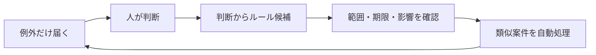

# AgentDesk Strategy — 大ヒットへの本質的変更

> 承認を速くさばくアプリから、**判断するほど承認そのものが減る仕組み**へ。仕様の判断基準は [design-system.md](./design-system.md)、製品原則は [philosophy.md](./philosophy.md)、実行計画は [TODO.md](../TODO.md)。

## 結論

AgentDeskが大ヒットするために変えるべき本質は一つ。**一回の判断を、その場限りで終わらせないこと。** スワイプがガードレールを育て、次からは類似案件が人間に届かなくなる。残るのは本当に人間が決めるべき例外だけ。

デザインの磨き込み（I-1004）は必要条件だが、十分条件ではない。十分条件は「判断するたびに自分の仕事が減る」体験である。

## 狙う体験

- 初日は10件届く。数日後には同じ仕事量なのに2件しか届かない。
- 空になった画面に件数ランキングは出さない。「3つのルールが確認作業を減らしています」と、取り戻した注意だけ見せる（P8、I-404の延長）。
- 初回体験は設定画面ではなく、**本物のエージェントの一件を承認し、動作が再開する瞬間**にする。

## 優先順位

1. **スワイプから安全な自動化ルールを育てる（P0）** — I-1003 / I-1005。承認・却下の直後に「今回だけ／同種を自動許可／金額・範囲・期間つきで許可」を選べる。適用範囲・期限・影響プレビュー・取り消しを必ず添える。ルールは観測でき、段階的で、取り消し可能（P6）。
2. **主要エージェントへ5分で接続（P0）** — I-903 / I-1006。Claude Code・Codex用フック、LangGraphのinterrupt、n8nノード等、完成済み導線を用意する。サンプルカードではなく実タスクが届くセットアップにする。
3. **安全性を検証可能な事実にする（P1）** — I-804 / I-208。自称のエージェント名・アイコンを信用しない。登録済みエージェントの身元確認、実行対象と権限範囲の検証、送信メール・変更値・実行コマンドのドライランプレビュー、承認内容と実行内容の一致確認、人間／ルール／自動を区別した監査ログ。
4. **高度な機能の発見可能性を整理（P1）** — I-1004。ピンチ・ダブルタップ・二段スワイプ・ドロップゾーンは近道として残し、同じ操作に明示的な入口を用意する。通常／詳細／高度の三段階開示を守る。
5. **その体験を色・動き・触覚で磨く（P2）** — [design-system.md](./design-system.md)。演出は理解と手応えのために使い、判断を急かさない。

## 最初の勝ち筋を絞る

汎用HITL基盤として何でも扱えることは変えない。ただし最初の訴求は絞る。

> **複数の自律エージェントを、スマホから監督する。PCを離れても止めない。危険な操作だけ届き、一度判断すれば徐々に任せられ、誰が何を許可したか残る。**

## 測るもの

- 初回接続から初回実承認までの時間（目標：5分以内）。
- 一人あたりの週間判断件数の減少（ルール育成の効果）。
- 例外率（届いたうち人間が本当に必要だった割合）。
- 高価値操作（金額・不可逆）のAgentDesk経由率（信頼の指標）。
- 測らないもの：承認件数・連続日数のランキング（I-404）。

## やらないこと

- ただのチャットアプリ化、野放しのAPIキー受け渡し（philosophy.mdのアンチゴール）。
- 件数を褒めるゲーミフィケーション。
- 隠しジェスチャーを知る人だけ使える高度機能（I-1004で明示入口を必須化）。
- 安全性の裏づけがないまま高価値操作の自動化を促すこと。
